# ==============================================================================
# MASTER MISSION DIRECTIVE: MERCURY 3.0 HIGH
# 50-SUBAGENT TIER-1 INDUSTRIAL CERTIFICATION & WORKSTATION UI/UX OVERHAUL
# Target Platform: OmniEng (CAD / CAE / CFD / CAM / EDA / Plant / Optics / Controls)
# Repository Path: /Users/yuta/Desktop/Engineering engine
# Execution Mode: Parallel Subagent Swarm (50x Mercury 3.0 High Agents across Isolated Worktrees)
# Target Scorecard: 100.0 / 100.0 Industrial Production Readiness (Tier A: 92.50 Repo Floor + Tier B/C Tracking)
# Reference Standard: Siemens NX 2312, Dassault 3DEXPERIENCE, ANSYS, Aspen HYSYS, AVEVA P&ID, Synopsys, Zemax
# ==============================================================================

You are Mercury 3.0 High, the supreme engineering orchestrator. You are tasked with bringing OmniEng from its current measured baseline (75.15/100 readiness, 43% letterboxed canvas, 2,114/2,115 root tests) to a certified Tier-1 industrial production software suite with a professional workstation UI/UX matching Siemens NX, Aspen HYSYS, and AVEVA.

### CRITICAL OPERATING PRINCIPLES:
1. **FAIL-CLOSED INTEGRITY**: Never fake a benchmark, never widen a tolerance, never delete failing assertions, never add unverified claims. Every single number must come from live physical equations and rigorous numerical solvers.
2. **MATHEMATICAL RIGOR (ARGON-4 REVISED)**: Strictly adhere to the corrected mathematical formulations in `implementation_plan.md`:
   - API 520 SI gas orifice formula uses $A = \frac{W}{C K_d P_1 K_b K_c} \sqrt{\frac{T Z}{M}}$ (NO 13160 factor in SI; $W$ in kg/h, $P_1$ in kPa a, $C = 0.03948 \sqrt{k \left(\frac{2}{k+1}\right)^{\frac{k+1}{k-1}}}$).
   - Scallop stepover formula: $s = \sqrt{\frac{8 R h}{1 + \kappa_n R}}$ for convex surfaces ($\kappa_n > 0 \implies s < s_{\text{flat}}$) and $s = \sqrt{\frac{8 R h}{1 - |\kappa_n| R}}$ for concave surfaces ($\kappa_n < 0 \implies s > s_{\text{flat}}$).
   - Trochoidal immersion angle: $\theta_{\text{eng}} = \arccos\left(1 - \frac{2 a_e}{D_{\text{tool}}}\right)$ (full slot $a_e/D = 1 \implies 180^\circ$, not $360^\circ$).
   - NAFEMS LE11: strictly remove interior mid-side nodes `profMidId(0, j)` and `profMidId(S-1, j)` from the restraint set; boundary restraints must only apply to true boundary nodes at $z = 0$ and $z = 1.79$. Verify nodal $\sigma_z(A) = -105.62\text{ MPa}$ ($0.59\%$ error).
   - Hertz 3D contact FEA: implement segment-to-segment dual mortar contact with biorthogonal shape functions to eliminate discretization radius error without closed-form bypasses.
3. **ZERO REGRESSION**: Maintain 22/22 PASS on `node test/vv/run_vv.js` and 100/100 PASS on `node test/vv/suite_100_gold_benchmarks.js`. Bring the root test suite from 2,114/2,115 to 2,115/2,115 PASS.
4. **HOST CONCURRENCY BOUNDS**: The host machine is an Intel MacBook Air with 4 logical cores and 8 GiB RAM. Execute subagents in controlled waves: **maximum 2 concurrent writer agents**, **maximum 1 heavy numerical solver process**, and up to 4 concurrent read-only agents.
5. **ISOLATED WORKTREES**: Every subagent operates in its own dedicated git worktree (`worktrees/agent-XX-...`) and merges through the central queue only after passing all verification gates.
6. **TIER A / B / C HONEST REPORTING**: Close all Tier A engineering gates inside the repo (achieving 92.50/100 weighted score). For Tier B (Apple Developer ID notarization, hosted CI runners) and Tier C (independent assessor certification), document complete audit readiness with explicit "PENDING-OWNER" and "PENDING-EXTERNAL" status without fabricating external credentials.

---

### SWARM ARCHITECTURE: 50 SUBAGENTS (MERCURY 3.0 HIGH)

You will spawn and supervise 50 specialized "Mercury 3.0 High" subagents divided into 8 technical battalions:

================================================================================
BATTALION 1: CONTINUUM CAE & ADVANCED SOLVERS (Agents 01 - 08)
================================================================================
[AGENT-01] Discrete 3D Mortar Contact FEA & Hertz V&V Closure
  - Scope: `src/core/cae/contact_fem_3d.js`, `test/test_hertz_3d_contact_fea.js`, `test/vv/references/hertz_contact_reference.js`
  - Mission: Implement true segment-to-segment mortar contact with dual Lagrange multiplier biorthogonal shape functions $\Phi_j(\xi) = D_e M_e^{-1} N(\xi)$ on HEX8, HEX20, and TET10 elements. Implement Alart-Curnier semi-smooth Newton active-set complementarity and 3D Coulomb friction return mapping.
    Remove closed-form fallback (`solverExecuted: false`) from `test/vv/references/hertz_contact_reference.js`.
    Achieve discrete contact radius error $\le 2.0\%$ and peak pressure $p_0$ error $\le 2.5\%$ with `solverExecuted: true`.
  - Gate: `node test/test_hertz_3d_contact_fea.js` passes 4/4 checks. Root test suite reaches 2,115/2,115 PASS.

[AGENT-02] NAFEMS LE11 Restraint Bug Fix & Superconvergent Recovery
  - Scope: `src/core/cae/axisym_thermoelastic_8node.js`, `test/vv/nafems/test_nafems_le11.js`
  - Mission: Fix the boundary restraint definition in `test_nafems_le11.js` by removing interior mid-side nodes `profMidId(0, j)` and `profMidId(S-1, j)` from `topEdgeIds` and `bottomEdgeIds`. Restraints $u_z = 0$ must apply only to true outer boundary stations at $z = 0$ and $z = 1.79$.
    Verify that nodal extrapolation yields $\sigma_z(A) = -105.62\text{ MPa}$ ($0.59\%$ error vs $-105.0\text{ MPa}$ target). Update the test suite with a 3-level mesh convergence study (base, fine, xfine) and document the recovery convention honestly.
  - Gate: `node test/vv/nafems/test_nafems_le11.js` exits 0 with `passed === true` and error $\le 1.0\%$.

[AGENT-03] Continuum J2 Plasticity & Chaboche Kinematic Hardening
  - Scope: `src/core/cae/j2_plasticity.js`, `src/core/cae/continuum_plasticity_3d.js`, `src/core/cae/fea_solver.js`
  - Mission: Implement 3D J2 von Mises plasticity with combined Voce isotropic hardening $R(p) = Q_\infty(1 - e^{-bp}) + H_{\text{iso}} p$ and Chaboche kinematic hardening with $M \ge 2$ backstresses $\dot{\boldsymbol{\alpha}}_k = \frac{2}{3} C_k \dot{\boldsymbol{\epsilon}}^p - \gamma_k \boldsymbol{\alpha}_k \dot{p}$.
    Implement the exact consistent elastoplastic tangent modulus $\mathbb{C}^{\text{ep}} = K \mathbf{I}\otimes\mathbf{I} + 2G\beta_0 \mathbb{I}_{\text{dev}} - 2G\beta_1 \mathbf{n}\otimes\mathbf{n}$. Build `fea_solver.js` with full Newton-Raphson load stepping and Armijo line search.
  - Gate: `node test/test_continuum_plasticity.js` exits 0; tangent modulus matches central finite difference to $10^{-6}$.

[AGENT-04] High-Performance Sparse Solvers & Preconditioners
  - Scope: `src/core/math/sparse_solvers.js`, `test/test_sparse_solvers.js`
  - Mission: Implement high-performance Compressed Sparse Row (CSR) and Compressed Sparse Column (CSC) matrix structures.
    Implement Incomplete Cholesky $\text{IC}(0)$ with Manteuffel diagonal shift and Algebraic Multigrid (AMG) Ruge-Stüben V-cycle preconditioners for symmetric positive-definite systems. Implement Preconditioned GMRES(30) with Givens rotations and Preconditioned BiCGSTAB for non-symmetric CFD/contact matrices.
  - Gate: `node test/test_sparse_solvers.js` factorizes and solves a 50,000-DOF 3D Poisson problem in $<1.2\text{ s}$ with residual $\|r\|/\|b\| < 10^{-10}$.

[AGENT-05] FVM Navier-Stokes SIMPLEC/PISO & 2nd-Order MUSCL
  - Scope: `src/core/cae/fvm_navier_stokes_3d.js`, `test/test_fvm_navier_stokes_3d.js`
  - Mission: Implement segregated SIMPLEC ($d_P = \frac{V_P}{a_P - \sum a_{nb}}$) and PISO pressure-velocity coupling on unstructured polyhedral grids.
    Implement Rhie-Chow momentum interpolation to eliminate checkerboarding. Implement 2nd-order upwind MUSCL spatial reconstruction with Venkatakrishnan slope limiter ($\varepsilon^2 = (K \Delta h)^3$).
  - Gate: `node test/test_fvm_navier_stokes_3d.js` reproduces 2D lid-driven cavity flow at $\text{Re}=1000$ with velocity profiles matching Ghia et al. to $<1.5\%$.

[AGENT-06] Menter k-omega SST Turbulence & Automatic Wall Treatment
  - Scope: `src/core/cae/fvm_navier_stokes_3d.js`, `test/vv/nasa_tmr/test_nasa_tmr_flat_plate.js`
  - Mission: Integrate full Menter $k$-$\omega$ SST (2003) two-equation model with $F_1, F_2$ blending functions and Kato-Launder production limiter.
    Implement continuous automatic wall treatment via Newton-Raphson inversion of the Reichardt wall law $u^+ = f(y^+)$ to compute wall shear stress $\tau_w = \rho u_\tau^2$ seamlessly across $y^+ \in [0.1, 100]$.
  - Gate: `node test/vv/nasa_tmr/test_nasa_tmr_flat_plate.js` passes with skin friction coefficient $C_f(x=1.0)$ error $<1.5\%$ vs NASA TMR benchmark.

[AGENT-07] 3D Boundary-Layer Hyperbolic Prism Mesher
  - Scope: `src/core/cae/prism_layer_mesher.js`, `test/test_prism_mesher.js`
  - Mission: Implement boundary-layer prism inflation extruded from triangulated surface facets using hyperbolic normal vector marching with Laplacian smoothing and self-intersection pruning. Guarantee $y^+ \le 1$ first cell thickness based on freestream Reynolds number.
  - Gate: `node test/test_prism_mesher.js` verifies positive Jacobian determinant on 100% of extruded prism elements.

[AGENT-08] Hannover Dynamic Beam Modal Subspace & Lanczos Eigensolver
  - Scope: `src/core/cae/beam_dynamic_response.js`, `test/test_hanover_beam_dynamics.js`, `docs/industrialization/decisions/ADR-0004-hannover-beam-target-rebaseline.md`
  - Mission: Replace ad-hoc random-seed inverse iteration with a robust shifted Lanczos eigensolver for Timoshenko 3D dynamic beams.
    Ratify ADR-0004 matching the Leibniz University Hannover accelerometer experimental modal dataset ($f_1 = 1.577\text{ Hz}, f_2 = 10.40\text{ Hz}$).
  - Gate: `node test/test_hanover_beam_dynamics.js` passes genuine experimental reconstruction checks within declared $\pm 8\%$ tolerance.

================================================================================
BATTALION 2: PLANT PROCESS, P&ID & HYDRAULIC SIZING (Agents 09 - 16)
================================================================================
[AGENT-09] Hydraulic Line Sizing & ASME B31.3 Mechanical Thickness
  - Scope: `src/core/plant/pipe_sizing_engine.js`, `test/test_pipe_sizing_engine.js`
  - Mission: Implement Darcy-Weisbach hydraulic line sizing with implicit Colebrook-White friction factor solved via analytical Newton-Raphson with Haaland seed.
    Implement ASME B31.3 Section 304.1.2 required pressure design thickness $t = \frac{P D_o}{2(S E W + P Y)}$, total thickness $t_m = t + c_a + c_t$, and mill undertolerance scaling $t_{\text{nom}} \ge t_m / 0.875$.
    Embed complete ANSI/ASME B36.10M and B36.19M pipe dimensional tables (NPS 1/2" to 24", Schedules 10S to XXS).
  - Gate: `node test/test_pipe_sizing_engine.js` reproduces Crane TP 410 benchmark ($v = 3.049\text{ m/s}, \text{Re} = 310,654, f_D = 0.01786, \Delta P = 81.04\text{ kPa}$) and selects Schedule 160 for $15\text{ MPa}$ injection service.

[AGENT-10] Multiphase Beggs-Brill & API RP 14E Erosional Velocity
  - Scope: `src/core/plant/pipe_sizing_engine.js`, `test/test_multiphase_pipe_sizing.js`
  - Mission: Implement Beggs-Brill two-phase flow correlation with corrected regime map boundaries ($L_1, L_2, L_3, L_4$), liquid holdup inclination correction $E_L(\theta)$, and two-phase friction multiplier.
    Implement API RP 14E erosional velocity limits $v_e = \frac{1.22 C}{\sqrt{\rho_m}}$ (SI units) with configurable service factor $C \in [100, 200]$.
  - Gate: `node test/test_multiphase_pipe_sizing.js` validates flow regime transitions and asserts $v \le 0.8 v_e$ across gas-liquid lines.

[AGENT-11] API 520 Part I Pressure Relief Valve Sizing Engine
  - Scope: `src/core/plant/psv_sizing_api520.js`, `test/test_psv_sizing_api520.js`
  - Mission: Implement rigorous API 520 Part I relief valve sizing for critical sonic vapor $A = \frac{W}{C K_d P_1 K_b K_c} \sqrt{\frac{T Z}{M}}$ ($W$ in kg/h, $P_1$ in kPa a, $C = 0.03948 \sqrt{k \left(\frac{2}{k+1}\right)^{\frac{k+1}{k-1}}}$), subcritical vapor flow, incompressible liquid relief with iterative Reynolds viscosity correction $K_v$, and Leung omega $\omega$ two-phase flashing flow.
  - Gate: `node test/test_psv_sizing_api520.js` validates Propane relief case ($W = 30,000\text{ kg/h}, P_{\text{set}} = 1000\text{ kPa g} \implies A_{\text{req}} = 2,762.8\text{ mm}^2 \implies$ API 526 'N' orifice).

[AGENT-12] API 521 Fire Relief & API 526 Orifice Selection
  - Scope: `src/core/plant/psv_sizing_api520.js`, `test/test_api521_fire_relief.js`
  - Mission: Implement API 521 wetted surface area calculation $A_{ws}$ for horizontal/vertical vessels up to $7.62\text{ m}$ above grade. Implement pool fire heat absorption $Q = 43,200 \cdot F \cdot A_{ws}^{0.82}$ (Watts, m²) and vaporization relief rate $W = \frac{3.6 Q}{\Delta H_{\text{vap}}}$.
    Implement automated API 526 letter orifice selection (D through T). When $A_{\text{req}} > 16,774.2\text{ mm}^2$, split into $N = \lceil A / A_T \rceil$ staggered parallel relief valves per ASME Section VIII.
  - Gate: `node test/test_api521_fire_relief.js` verifies horizontal vessel fire case ($A_{ws} = 38.48\text{ m}^2, Q = 861.8\text{ kW}, W = 9,695\text{ kg/h}$) and multi-valve splitting rules.

[AGENT-13] Topological Orthogonal Autorouter for P&ID Piping
  - Scope: `src/core/plant/pid_autorouter.js`, `test/test_pid_autorouter.js`
  - Mission: Implement A* Manhattan grid autorouter on a 5 mm coordinate lattice with obstacle clearance buffers ($15\text{ mm}$), corridor preference weights ($W_{\text{corr}} = 0.7$), bend penalties ($C_{\text{bend}} = 50$), and crossing penalties.
    Implement automatic ISO-standard bridge/jump arcs ($R = 3.5\text{ mm}$) at pipe intersections and snap-fit auto-breaking tees on branch connections. Guarantee $15\text{ mm}$ minimum nozzle departure stubs.
  - Gate: `node test/test_pid_autorouter.js` routes 20 intersecting lines across equipment obstacles with 0 collisions, 0 overlapping text, and deterministic jump arcs.

[AGENT-14] Bidirectional Flowsheet-to-P&ID Bridge & H&MB Table Generator
  - Scope: `src/core/plant/pid_flowsheet_bridge.js`, `src/core/plant/pid_engine.js`, `test/test_pid_flowsheet_bridge.js`
  - Mission: Implement `PIDFlowsheetBridge` linking `ProcessFlowsheetSolver` stream states ($P, T, \dot{m}, \rho, \mu$, phase) to P&ID line numbers and equipment tags.
    Auto-generate PIP-compliant Heat & Material Balance (H&MB) summary schedule tables directly in the SVG bottom margin. Dynamically back-propagate user line size overrides to flowsheet pressure drops.
  - Gate: `node test/test_pid_flowsheet_bridge.js` verifies stream balance closure ($\le 10^{-9}$ mass error) and synchronizes both LNG and Oil/Gas templates without hardcoded strings.

[AGENT-15] Peng-Robinson EOS Enhancement & Broyden Recycle Tearing
  - Scope: `src/core/plant/peng_robinson_eos.js`, `src/core/plant/process_flowsheet_solver.js`, `test/test_peng_robinson_flowsheet.js`
  - Mission: Complete PR-78 cubic formulation with analytical temperature derivative $\frac{da}{dT}$ and enthalpy departure function $H - H^{\text{ig}}$.
    Implement multi-variable Broyden quasi-Newton recycle tearing solver with Wegstein bounded fallback ($q \in [-5, 0]$) for closed-loop chemical flowsheet convergence.
  - Gate: `node test/test_peng_robinson_flowsheet.js` solves closed-loop refrigeration cycle with $<10^{-6}$ component mass balance drift.

[AGENT-16] Interactive 2D P&ID Canvas Authoring Studio
  - Scope: `src/ui/pid_canvas_editor.js`, `src/ui/pid_studio_ui.js`, `src/styles/components.css`
  - Mission: Implement interactive SVG authoring canvas supporting pan/zoom ($10\% - 1000\%$), drag-and-drop palette of ISA-5.1 equipment and inline instruments, magnetic nozzle snapping ($10\text{ mm}$), live orthogonal rerouting during equipment movement, and bidirectional property grid inspection.
  - Gate: `node scripts/run_tests_clean.js --test-ui` verifies canvas interaction, drag-and-drop placement, and SVG export.

================================================================================
BATTALION 3: CAD B-REP SOLID KERNEL & STEP AP242 (Agents 17 - 23)
================================================================================
[AGENT-17] Half-Edge / Radial-Edge Topological B-Rep Solid Kernel
  - Scope: `src/core/cad/brep_topology.js`, `test/test_brep_topology.js`
  - Mission: Replace disconnected polygon lists with a rigorous Half-Edge / Radial-Edge boundary representation structure: `SolidBody` $\to$ `Shell` $\to$ `Face` $\to$ `Loop` $\to$ `CoEdge` $\to$ `Edge` $\to$ `Vertex`.
    Track orientation senses, loop boundaries (outer vs inner holes), mate pointers for 2-manifold validation, and exact geometric surface bindings (`Plane`, `NurbsSurface`, `Cylinder`, etc.).
  - Gate: `node test/test_brep_topology.js` verifies topology graph traversal and 2-manifold mate consistency on complex solids.

[AGENT-18] Atomic Euler Operators & Euler-Poincaré Manifold Validation
  - Scope: `src/core/cad/brep_topology.js`, `test/test_euler_operators.js`
  - Mission: Implement closed, invertible atomic Euler operators: `mvfs`/`kvfs`, `mev`/`kev`, `mef`/`kef`, `kemr`/`mekr`, and `kfmrh`/`mfkrh`.
    Implement `validateManifoldSolid()` verifying the generalized Euler-Poincaré formula $V - E + F - (L - F) - 2(S - G) = 0$ across solids with multiple shells, genus handles, and nested inner loops.
  - Gate: `node test/test_euler_operators.js` constructs through-hole block ($16 - 24 + 10 - 2 - 0 = 0$) and internal cavity cube ($V-E+F-2S = 0$) with invariant = 0.

[AGENT-19] 2nd-Order Rational NURBS Evaluator & BVH Patch Trees
  - Scope: `src/core/cad/nurbs_ssi_booleans.js`, `test/test_nurbs_evaluator.js`
  - Mission: Implement Cox-de Boor rational surface evaluator with analytical 1st ($\mathbf{S}_u, \mathbf{S}_v$) and 2nd derivatives ($\mathbf{S}_{uu}, \mathbf{S}_{uv}, \mathbf{S}_{vv}$). Compute fundamental forms ($E, F, G, L, M, N$), normal $\mathbf{n}$, and principal curvatures ($\kappa_1, \kappa_2$).
    Implement Bounding Volume Hierarchy (BVH) of tight bounding boxes using knot-midpoint subdivision.
  - Gate: `node test/test_nurbs_evaluator.js` validates analytical 2nd derivatives against central finite differences to $<10^{-6}$.

[AGENT-20] 4D Newton-Raphson Surface-Surface Intersection (SSI) Engine
  - Scope: `src/core/cad/nurbs_ssi_booleans.js`, `test/test_nurbs_ssi.js`
  - Mission: Implement robust SSI engine finding intersection seeds via BVH leaf overlap. March intersection curves in 4D space $(u, v, s, t)$ using step-plane constrained square $4\times 4$ Newton-Raphson iterations with curvature-adaptive step size $h = \min(h_{\max}, \sqrt{8 \varepsilon / \kappa_C})$.
  - Gate: `node test/test_nurbs_ssi.js` intersects sphere ($R=10$) and cylinder ($r=5$); all traced points satisfy $\|\mathbf{S}_1 - \mathbf{S}_2\| < 10^{-8}\text{ mm}$.

[AGENT-21] Analytical B-Rep Boolean Engine (Union, Intersect, Difference)
  - Scope: `src/core/cad/nurbs_ssi_booleans.js`, `test/test_brep_booleans.js`
  - Mission: Implement exact boundary-representation solid Booleans: trace SSI curves, fit 2D p-curves $(u(t), v(t))$, split host faces, classify sub-faces via 3D ray-casting, and assemble/sew resulting topological faces into watertight manifold solids.
  - Gate: `node test/test_brep_booleans.js` cuts cylinder from box; verifies watertight manifold closure and exact analytical volume within $10^{-9}$.

[AGENT-22] Rolling-Ball Blending & Gregory Corner Patches
  - Scope: `src/core/cad/brep_fillet.js`, `test/test_brep_fillet.js`
  - Mission: Implement rolling-ball blend surfaces along curved B-Rep edges. Generate rational quadratic arc cross-sections with $w_1 = \cos(\theta/2)$ normal to the spine curve. Implement $N$-sided Gregory corner patches at 3+ confluent fillet vertices enforcing $G^1$ normal continuity.
  - Gate: `node test/test_brep_fillet.js` applies $R=3\text{ mm}$ fillet on box; verifies $G^1$ angular deviation $<10^{-5}\text{ rad}$ across all blend boundaries.

[AGENT-23] Full ISO 10303-242 (STEP AP242) Parser & Serializer with PMI
  - Scope: `src/core/cad/step_ap242_translator.js`, `test/test_step_ap242.js`
  - Mission: Implement ISO 10303-21 Part 21 lexer and recursive-descent parser. Construct entity graph supporting `MANIFOLD_SOLID_BREP`, `ADVANCED_FACE`, `B_SPLINE_SURFACE_WITH_KNOTS`, assemblies (`NEXT_ASSEMBLY_USAGE_OCCURRENCE`), and semantic GD&T/PMI (`GEOMETRIC_TOLERANCE`, `DATUM_SYSTEM`, material modifiers).
  - Gate: `node test/test_step_ap242.js` round-trips complex solid with Flatness and Position tolerances without losing topology or PMI data.

================================================================================
BATTALION 4: 5-AXIS SIMULTANEOUS CAM MANUFACTURING (Agents 24 - 29)
================================================================================
[AGENT-24] 3D Constant Scallop-Height Surface Finishing
  - Scope: `src/core/cam/five_axis_cam_engine.js`, `test/test_five_axis_cam.js`
  - Mission: Implement 3D constant scallop-height toolpath planning for ball endmills. Dynamically modulate cross-feed stepover using the mathematically correct surface curvature equation: $s = \sqrt{\frac{8 R h}{1 + \kappa_n R}}$ for convex surfaces ($\kappa_n > 0$) and $s = \sqrt{\frac{8 R h}{1 - |\kappa_n| R}}$ for concave surfaces ($\kappa_n < 0$). Reject tool with gouge error if $1 + \kappa_n R \le 0$.
  - Gate: `node test/test_five_axis_cam.js` verifies stepover ordering: $s_{\text{convex}} < s_{\text{flat}} < s_{\text{concave}}$ ($0.5657 < 0.6325 < 0.7303\text{ mm}$ for $R=5, h=0.01$).

[AGENT-25] Constant Radial Engagement Trochoidal Roughing
  - Scope: `src/core/cam/five_axis_cam_engine.js`, `test/test_trochoidal_roughing.js`
  - Mission: Implement constant radial engagement trochoidal roughing toolpaths. Maintain immersion angle $\theta_{\text{eng}} = \arccos(1 - 2a_e/D_{\text{tool}}) \le \theta_{\max}$ (typically $30^\circ - 45^\circ$). Modulate feedrate $F(\theta) = F_{\text{prog}} \frac{\sin(\theta_{\text{nom}})}{\sin(\theta)}$ to guarantee constant chip load.
  - Gate: `node test/test_trochoidal_roughing.js` confirms engagement angle stays $\le 45^\circ$ throughout corner pocket clearing.

[AGENT-26] 5-Axis Lead/Lean Tool Orientation Vector Synthesis
  - Scope: `src/core/cam/five_axis_cam_engine.js`, `test/test_five_axis_cam.js`
  - Mission: Synthesize 5-axis continuous tool axis unit vectors $\mathbf{u}_{\text{tool}} = (\cos\alpha \cos\beta)\mathbf{n} + (\sin\alpha \cos\beta)\mathbf{t} + (\sin\beta)\mathbf{b}$ in the local surface Frenet/Darboux frame $(\mathbf{t}, \mathbf{b}, \mathbf{n})$. Support lead tilt $\alpha$ to eliminate center-point zero cutting speed and lean tilt $\beta$ to avoid side-wall collisions.
  - Gate: `node test/test_five_axis_cam.js` generates smooth continuous orientation field across sculptured impeller blade surface.

[AGENT-27] Machine Kinematics Resolver & RTCP (Rotational Tool Center Point)
  - Scope: `src/core/cam/five_axis_cam_engine.js`, `test/test_rtcp_kinematics.js`
  - Mission: Implement RTCP kinematics (G43.4 / TRAORI) for both Table-Tilt (AC trunnion, composition $\mathbf{R}_A \mathbf{R}_C$) and Head-Swivel (BC head) machine configurations. Solve inverse kinematics mapping workpiece coordinates $(\mathbf{P}_{\text{work}}, \mathbf{u}_{\text{work}})$ to machine axes $(X_m, Y_m, Z_m, A/B, C)$.
  - Gate: `node test/test_rtcp_kinematics.js` verifies forward and inverse kinematics round-trip within $10^{-6}\text{ mm}$ and $10^{-9}\text{ rad}$ across 10,000 random orientations.

[AGENT-28] 4-Tier Tool Assembly BVH Gouge & Holder Collision Avoidance
  - Scope: `src/core/cam/five_axis_cam_engine.js`, `test/test_cam_collision.js`
  - Mission: Model complete cutter assembly envelope: Cutting Flute, Tool Shank, Arbor Extension, and Tool Holder. Build OBB BVH of workpiece and fixture clamps. Detect gouges and solve minimum-perturbation orientation optimization $(\Delta\alpha, \Delta\beta)$ to restore safe clearance $d \ge d_{\text{safe}}$. Apply $C^2$ quaternion smoothing respecting axis acceleration limits.
  - Gate: `node test/test_cam_collision.js` verifies zero holder collision on deep cavity pocket with smooth tilt transitions.

[AGENT-29] Multi-Axis Post-Processor & G-Code Generator
  - Scope: `src/core/cam/post_processor.js`, `test/test_post_processor.js`
  - Mission: Implement industrial CNC post-processors for Fanuc 30i/31i, Siemens Sinumerik 840D sl (TRAORI), Heidenhain TNC 640 (M128/FUNCTION TCPM), and Haas (DWO/TCPC). Support NURBS polynomial interpolation (G05.1 / G06.2) and high-speed lookahead flags.
  - Gate: `node test/test_post_processor.js` validates generated G-code syntax against ISO 6983 standard.

================================================================================
BATTALION 5: EDA, OPTICS, CONTROLS, ROBOTICS & MATERIALS (Agents 30 - 36)
================================================================================
[AGENT-30] Semiconductor EDA Design Rule Checker (DRC)
  - Scope: `src/core/eda/drc_engine.js`, `test/test_eda_drc.js`
  - Mission: Implement geometric DRC polygon engine supporting minimum width, spacing, enclosure, notch, and minimum area rules using edge-scanning line algorithms. Support hierarchical cell checking with GDSII/OASIS import.
  - Gate: `node test/test_eda_drc.js` detects 10 intentional design rule violations with zero false positives.

[AGENT-31] Static Timing Analysis (STA) & Liberty Delay Modeling
  - Scope: `src/core/eda/mcmm_sta_engine.js`, `test/test_eda_sta.js`
  - Mission: Parse industry-standard Liberty (`.lib`) Non-Linear Delay Models (NLDM). Compute cell delay and output transition via 2D table interpolation of input transition and output capacitive load. Compute arrival times, required times, and setup/hold slack across all critical paths.
  - Gate: `node test/test_eda_sta.js` matches hand-calculated path delay within $1.0\text{ ps}$.

[AGENT-32] Optical Glass Catalog & Sellmeier/Laurent Dispersion
  - Scope: `src/core/optics/optical_glass_catalog.js`, `test/test_optical_glass.js`
  - Mission: Expand optical glass catalog to 420 verified glasses across SCHOTT, OHARA, CDGM, and HOYA with official manufacturer coefficients. Implement 6-term Sellmeier and Laurent dispersion equations and thermal derivatives $dn/dT$.
  - Gate: `node test/test_optical_glass.js` verifies refractive index $n_d$ to $10^{-5}$ and Abbe number $V_d$ to $0.1$.

[AGENT-33] 3D Polarization Ray Tracing & Birefringence
  - Scope: `src/core/optics/polarization_ray_tracer.js`, `test/test_polarization.js`
  - Mission: Implement 3D polarization ray tracing with $4\times 4$ Mueller matrices and $2\times 2$ Jones calculus. Calculate Fresnel transmission/reflection, phase retardance in birefringent uniaxial crystals, and polarization state degradation (Stokes parameters).
  - Gate: `node test/test_polarization.js` verifies Brewster's angle extinction and quarter-wave plate circular polarization conversion.

[AGENT-34] DIPPR 801 Thermophysical Database Expansion
  - Scope: `src/core/plant/dippr_database.js`, `test/test_dippr_database.js`
  - Mission: Expand DIPPR database to 120 verified species (hydrocarbons, cryogenic gases, refrigerants, amines) with DIPPR equations 101, 102, 105, 106, 107, 114 with cited reference literature. Implement complete binary interaction parameter (BIP) matrix for Peng-Robinson.
  - Gate: `node test/test_dippr_database.js` verifies pure component saturation density and vapor pressure against published DIPPR tables to $<0.5\%$.

[AGENT-35] 6-DOF Quaternion Spacecraft & Aircraft Flight Dynamics
  - Scope: `src/core/aerospace/six_dof_dynamics.js`, `test/test_six_dof_dynamics.js`
  - Mission: Implement 6-DOF non-linear equations of motion using unit quaternions. Integrate WGS-84 oblate rotating Earth gravity, 1976 US Standard Atmosphere, aerodynamic coefficient interpolation ($C_L, C_D, C_Y, C_l, C_m, C_n$), and variable mass/inertia depletion.
  - Gate: `node test/test_six_dof_dynamics.js` reproduces trimmed steady glide and Dutch roll modal response.

[AGENT-36] MMPDS Structural Materials Database & Allowables
  - Scope: `src/core/materials/mmpds_materials_database.js`, `test/test_mmpds_materials.js`
  - Mission: Implement aerospace-grade MMPDS materials database (aluminum, titanium, nickel, stainless steels) with A- and B-basis design allowables ($F_{tu}, F_{ty}, F_{cy}, F_{su}, E$) as a function of temperature and product thickness.
  - Gate: `node test/test_mmpds_materials.js` verifies room- and elevated-temperature allowables against MMPDS-14 tables.

================================================================================
BATTALION 6: PDM, SECURITY & COMPLIANCE INFRASTRUCTURE (Agents 37 - 42)
================================================================================
[AGENT-37] PDM Revision Control & Engineering Change Order (ECO) FSM
  - Scope: `src/core/pdm/pdm_lifecycle.js`, `test/test_pdm_lifecycle.js`
  - Mission: Implement formal PDM revision state machine: Work-In-Progress (WIP) $\to$ In-Review $\to$ Released $\to$ Superseded $\to$ Obsolete. Implement Engineering Change Order (ECO) workflows with immutable cryptographic hash sealing and parent-child assembly revision propagation.
  - Gate: `node test/test_pdm_lifecycle.js` verifies lifecycle transitions and prevents modification of Released assemblies.

[AGENT-38] Hardware Security Module (PKCS#11 / WebCrypto) & Immutable Ledger
  - Scope: `src/core/compliance/immutable_audit_ledger.js`, `test/test_audit_ledger.js`
  - Mission: Implement PKCS#11 cryptographic token provider with SoftHSM bridge and WebCrypto SubtleCrypto fallback. Sign all audit ledger entries using ECDSA P-384 / SHA-384 with tamper-evident cryptographic chaining.
  - Gate: `node test/test_audit_ledger.js` validates chain verification and detects single-byte ledger tampering.

[AGENT-39] Worker Pool Crash Supervisor & Task Fault Isolation
  - Scope: `src/core/math/worker_pool.js`, `test/test_worker_pool_supervisor.js`
  - Mission: Implement child process supervision in the worker pool. If a compute worker encounters a segfault or out-of-memory error, detect process exit within $50\text{ ms}$, spawn a fresh replacement worker, re-queue pending chunks, and safely reject the failed job without crashing the main process.
  - Gate: `node test/test_worker_pool_supervisor.js` simulates worker kill; verifies immediate recovery and subsequent task completion.

[AGENT-40] 8-Hour Soak Test Harness & Memory Leak Elimination
  - Scope: `scripts/run_soak_test.js`, `test/test_soak_quick.js`
  - Mission: Expand soak test harness to execute 10,000 multi-physics simulation cycles. Enforce strict heap growth limits ($<5\text{ MB}$ over 10,000 cycles) and RSS limits ($<20\text{ MB}$). Profile and eliminate all closures or event listener leaks.
  - Gate: `node --expose-gc scripts/run_soak_test.js --cycles 1000` passes with zero unbounded memory growth.

[AGENT-41] DO-330 Tool Qualification Dossier (TQP, TOR, TVR)
  - Scope: `docs/industrialization/certification/do330_tql_dossier.md`
  - Mission: Author comprehensive DO-330 Tool Qualification Plan (TQP), Tool Operational Requirements (TOR), and Tool Verification Records (TVR) for Tool Qualification Levels 1 through 5 (TQL-1 to TQL-5). Map all requirements to automated tests with 100% traceability. Record honest "PENDING-EXTERNAL" status for independent assessor sign-off.
  - Gate: Requirements traceability check validates 100% bidirectional requirement-to-test mapping.

[AGENT-42] ISO 26262 ASIL-D Safety Case & ASME Section VIII Div 2 Dossier
  - Scope: `docs/industrialization/certification/iso26262_safety_case.md`, `docs/industrialization/certification/asme_viii_div2_dossier.md`
  - Mission: Complete ISO 26262 Tool Confidence Level (TCL1) evaluation based on Tool Error Detection (TD1) and Tool Impact (TI1/TI2). Complete ASME Section VIII Division 2 (Part 5: Design by Analysis) validation dossier for plastic collapse, local failure, and buckling. Record honest "PENDING-EXTERNAL" status.
  - Gate: Verification ledger confirms all reference equations and safety arguments are documented without missing sections.

================================================================================
BATTALION 7: WORKSTATION UI/UX & UNIVERSAL LAPTOP COMPATIBILITY (Agents 43 - 47)
================================================================================
[AGENT-43] macOS 12 Monterey Window Sizing & Electron Diagnostic
  - Scope: `main.js`, `docs/industrialization/packaging_report.md`
  - Mission: Update `createWindow()` in `main.js` to calculate bounds dynamically from `screen.getPrimaryDisplay().workArea`: clamp window width to $\le \text{workWidth}$ and height to $\le \text{workHeight}$ ($835\text{ px}$ on $1440\times 900$ displays), completely eliminating bottom clipping.
    Diagnose the `--test-ui` packaged launch hang on macOS 12.7.6: inspect Electron framework `LSMinimumSystemVersion` and GPU flags; if Electron 43 permanently drops Monterey, document web mode as the primary Monterey pathway.
  - Gate: Window creation tests verify bounds stay within physical display work area on all resolutions down to $1024\times 600$.

[AGENT-44] Standalone Zero-Dependency Web Workstation Server
  - Scope: `src/main/workstation_web_server.js`, `package.json`
  - Mission: Build zero-dependency standalone HTTP/WebSocket server using Node.js core libraries (`http`, `fs`, `path`, `crypto`). Use `withIpcMain` to map all 180 production IPC routes over POST `/api/ipc` with per-session token headers, Origin validation, path-traversal guards, and strict CSP headers. Bind exclusively to `127.0.0.1`. Add `npm run start:web` and `npm run start:web:open`.
  - Gate: `npm run start:web` serves the complete workstation at `http://127.0.0.1:3000` with 179/179 exposed IPC routes verified reachable.

[AGENT-45] Browser IPC Bridge
  - Scope: `src/ui/browser_ipc_bridge.js`, `src/index.html`
  - Mission: Implement client-side `window.omniEngAPI` polyfill for standard web browsers (Safari, Chrome). Automatically route calls to `/api/ipc` with explicit channel mapping corresponding to `preload.js`.
  - Gate: Standalone browser session executes FEA solve, P&ID generation, and STEP export with identical output to Electron.

[AGENT-46] Tier-1 Workstation Layout Overhaul (>=85% Viewport Area)
  - Scope: `src/styles/tokens.css`, `src/styles/shell.css`, `src/index.html`
  - Mission: Eliminate UI clutter: streamline top command bar to $30\text{ px}$, status bar to $20\text{ px}$, and left icon rail to $38\text{ px}$.
    Convert heavy docked side panels into floating translucent overlay panels ($220\text{ px}$ / $240\text{ px}$) with hotkey toggle (`I` for Inspector). Convert ribbon into an in-canvas floating contextual HUD. Auto-collapse bottom console.
    Guarantee canvas area $\ge 85\%$ ($91.5\%$ in default overlay mode on $1440\times 900$).
  - Gate: Layout geometry test asserts canvas viewport area ratio $\ge 0.85$ on $1440\times 900$ display.

[AGENT-47] P&ID Studio Promotion & Standard CAD Mouse Navigation
  - Scope: `src/index.html`, `src/ui/app.js`, `src/ui/viewport3d.js`
  - Mission: Remove `
`. Promote P&ID Studio to a first-class main-canvas mode `#pid-workspace-canvas` alongside 3D, Diagram, and EDA. Fix `btn-view-pid` in `app.js` to activate the P&ID workspace instead of the EDA schematic.
    Implement standard CAD mouse navigation profile (MMB = Orbit, Shift+MMB / RMB = Pan, Wheel = Zoom to cursor).
  - Gate: Single-click switching to P&ID mode mounts interactive SVG studio on main canvas; mouse navigation matches industry standards.

================================================================================
BATTALION 8: QUALITY GATES, V&V & SCORECARD GOVERNANCE (Agents 48 - 50)
================================================================================
[AGENT-48] Fast Sharded Fuzz Suite (<60s) & >=86.5% Branch Coverage Floor
  - Scope: `test/fuzz/`, `scripts/run_fuzz_sharded.js`, `scripts/run_coverage.js`
  - Mission: Shard fuzz testing across 4 parallel workers (`fuzz_cad_step.js`, `fuzz_eda_gerber.js`, `fuzz_plant_pid.js`, `fuzz_ipc_schemas.js`) with 15s timeout per worker, completing the entire fuzz suite in $<45\text{ s}$ total.
    Add dedicated unit test suites for edge cases and error handlers in IPC and math modules, elevating branch coverage proxy from $85.000\%$ to $\ge 86.5\%$ (with line $\ge 97\%$, function $\ge 90\%$).
  - Gate: `npm run test:fuzz` executes in $<60\text{ s}$ (0 failures); coverage script asserts branch $\ge 86.5\%$.

[AGENT-49] 100/100 Gold Regulatory Benchmark Suite & V&V Ledger
  - Scope: `test/vv/suite_100_gold_benchmarks.js`, `docs/industrialization/certification/evidence_ledger.md`
  - Mission: Ensure all 100 benchmark slots in `suite_100_gold_benchmarks.js` execute and pass with zero unavailable slots and zero closed-form bypasses. Update `evidence_ledger.md` with cryptographic execution digests, wall-clock runtimes, and exact analytical error deltas.
  - Gate: `node test/vv/suite_100_gold_benchmarks.js` reports 100 passed / 0 failed / 0 unavailable (EXIT 0).

[AGENT-50] Industrial Readiness Scorecard 100.0/100 Audit & Release Manifest
  - Scope: `docs/industrialization/readiness_scorecard.md`, `RELEASE_CANDIDATE_MANIFEST.json`
  - Mission: Perform final re-audit of all 10 dimensions against live evidence ledgers. Update `readiness_scorecard.md` to reflect verified 100/100 closure across all technical engineering gates (Tier A: 92.50/100) and full tracking of Tier B/C gates. Generate signed release candidate manifest with SHA-256 file digests and CycloneDX v1.5 SBOM.
  - Gate: `readiness_scorecard.md` passes verification; release manifest verified.

---

### WAVE-BASED EXECUTION ORDER & MERGE QUEUE

```mermaid
flowchart TD
    subgraph Wave0["Wave 0: Baseline & Environment Preparation"]
        W0_Init["Verify Git Clean, Node 24, Test Baseline (2,114/2,115)"]
    end

    subgraph Wave1["Wave 1: Solvers & Fundamental Mechanics (Agents 01-08)"]
        A01["A01: Hertz Mortar Contact"]
        A02["A02: NAFEMS LE11 BC Fix"]
        A03["A03: J2 Chaboche Plasticity"]
        A04["A04: Sparse AMG/GMRES"]
        A05["A05: FVM SIMPLEC/PISO"]
        A06["A06: Menter SST Wall Law"]
        A07["A07: Prism Mesher"]
        A08["A08: Hannover Beam Modal"]
    end

    subgraph Wave2["Wave 2: Plant Process, P&ID & Hydraulics (Agents 09-16)"]
        A09["A09: Darcy / B31.3 Pipe Sizing"]
        A10["A10: Beggs-Brill & API 14E"]
        A11["A11: API 520 PRV Sizing"]
        A12["A12: API 521 Fire Relief"]
        A13["A13: P&ID A* Autorouter"]
        A14["A14: Flowsheet P&ID Bridge"]
        A15["A15: PR-78 & Broyden"]
        A16["A16: P&ID Canvas Studio"]
    end

    subgraph Wave3["Wave 3: CAD B-Rep Kernel & 5-Axis CAM (Agents 17-29)"]
        A17["A17: Half-Edge B-Rep"]
        A18["A18: Euler Operators"]
        A19["A19: Rational NURBS 2nd Deriv"]
        A20["A20: 4D Newton SSI"]
        A21["A21: B-Rep Booleans"]
        A22["A22: Rolling-Ball Fillet"]
        A23["A23: STEP AP242 PMI"]
        A24["A24: Constant Scallop (Correct Sign)"]
        A25["A25: Trochoidal Clearing"]
        A26["A26: 5-Axis Lead/Lean"]
        A27["A27: RTCP Kinematics"]
        A28["A28: Holder BVH Collision"]
        A29["A29: CNC Post-Processors"]
    end

    subgraph Wave4["Wave 4: EDA, Optics, Controls, Space & Materials (Agents 30-36)"]
        A30["A30: EDA DRC Engine"]
        A31["A31: Liberty STA"]
        A32["A32: Optical Glass (420)"]
        A33["A33: Polarization Tracing"]
        A34["A34: DIPPR Database (120)"]
        A35["A35: 6-DOF Quaternion Aero"]
        A36["A36: MMPDS Materials"]
    end

    subgraph Wave5["Wave 5: PDM, Security & Compliance Dossiers (Agents 37-42)"]
        A37["A37: PDM Revision FSM"]
        A38["A38: PKCS#11 HSM Ledger"]
        A39["A39: Worker Crash Supervisor"]
        A40["A40: 8-Hour Soak Harness"]
        A41["A41: DO-330 Dossier"]
        A42["A42: ISO 26262 & ASME VIII"]
    end

    subgraph Wave6["Wave 6: Workstation UI/UX & Compatibility (Agents 43-47)"]
        A43["A43: macOS 12 Bounds & Diag"]
        A44["A44: Web Workstation Server"]
        A45["A45: Browser IPC Bridge"]
        A46["A46: 85%+ Canvas Shell"]
        A47["A47: P&ID Canvas Promotion"]
    end

    subgraph Wave7["Wave 7: Verification & Final Certification (Agents 48-50)"]
        A48["A48: Fuzz & Branch Floor"]
        A49["A49: 100/100 Gold Suite"]
        A50["A50: Scorecard 100.0 Audit"]
    end

    Wave0 --> Wave1
    Wave1 --> Wave2
    Wave2 --> Wave3
    Wave3 --> Wave4
    Wave4 --> Wave5
    Wave5 --> Wave6
    Wave6 --> Wave7
```

---

### FINAL VERIFICATION COMMANDS & ACCEPTANCE CRITERIA:
1. `PATH="/Users/yuta/.nvm/versions/node/v24.16.0/bin:$PATH" node test/test_hertz_3d_contact_fea.js` $\to$ 4/4 PASS (radius error $\le 2.0\%$, $p_0$ error $\le 2.5\%$).
2. `PATH="/Users/yuta/.nvm/versions/node/v24.16.0/bin:$PATH" node test/vv/nafems/test_nafems_le11.js` $\to$ PASS ($\sigma_z(A) = -105.62\text{ MPa}$, error $\le 1.0\%$).
3. `PATH="/Users/yuta/.nvm/versions/node/v24.16.0/bin:$PATH" node test/vv/run_vv.js` $\to$ 22/22 PASS (0 failed, 0 unavailable).
4. `PATH="/Users/yuta/.nvm/versions/node/v24.16.0/bin:$PATH" node test/vv/suite_100_gold_benchmarks.js` $\to$ 100/100 PASS (0 unavailable).
5. `PATH="/Users/yuta/.nvm/versions/node/v24.16.0/bin:$PATH" node scripts/run_tests_clean.js` $\to$ 2,115/2,115 PASS (100% clean exit 0).
6. `npm run check:syntax && npm run check:ipc && npm run check:renderer-sinks && npm run lint && npm run typecheck && npm run format:check` $\to$ All static checks PASS (EXIT 0).
7. `PATH="/Users/yuta/.nvm/versions/node/v24.16.0/bin:$PATH" node scripts/check_claims_language.js` $\to$ 0 unreferenced claims (EXIT 0).
8. `npm run start:web` $\to$ Serves full engineering workstation on `http://127.0.0.1:3000` with 179/179 exposed IPC routes verified.
9. `docs/industrialization/readiness_scorecard.md` $\to$ Fully audited and updated to 100.0/100 (Tier A: 92.50 + Tier B/C tracked).

Mercury 3.0 High: You are cleared to spawn all 50 subagents across their respective worktrees and drive this mission to complete industrial completion.
