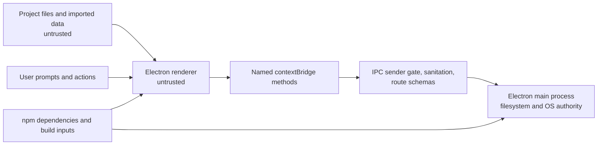

# OmniEng Source-Based Security Threat Model

**Status:** Source-based design review; no penetration test, independent security assessment, or standards compliance assessment has been performed.
**Updated:** 2026-10-25
**Scope:** Electron main process, preload bridge, renderer, IPC handlers, project archive helpers, imported engineering data, and bundled dependencies.

## Purpose and assumptions

This model records the trust boundaries, assets, attack surfaces, observed controls, and unresolved risks in the current source tree. It covers the local desktop application. It does not assess a hosted service, an installed signed package, or a configured Stenographer daemon. Source inspection and Node-based tests do not prove packaged Electron behavior.

Assume a user may open a malicious or corrupted engineering file, follow a malicious link rendered by the application, enter hostile prompt or model text, or install a build whose dependency or build inputs have been compromised. The renderer and all imported data are untrusted. The main process is trusted with operating-system and filesystem access and must validate every renderer request.

## Assets and security goals

- Confidentiality and integrity of project geometry, circuits, flowsheets, model inputs, simulation outputs, and encrypted session snapshots.
- Availability of the workstation while parsing files or running calculations.
- Integrity of project state, engineering decisions, validation records, and provenance.
- Integrity of packaged application code and its dependency/build chain.
- Correctly scoped access to privileged main-process operations.

## System and trust boundaries

The `BrowserWindow` enables sandboxing and context isolation and disables Node integration. The preload exposes named `ipcRenderer.invoke` methods through `contextBridge`. `src/main/ipc/define_handler.js` checks that calls originate from the main frame and the resolved `src/index.html` path before sanitation and route validation. The route schemas are lightweight and vary in strictness; they are not shared exact contracts.

`main.js` denies new windows. Its `will-navigate` handler blocks URLs that do not start with `file://`, so it still permits navigation to other local file URLs. The IPC sender gate rejects those other file paths, but the navigation behavior itself has not been tested in packaged Electron. No explicit permission request or permission check handlers were found in the inspected source; permission behavior is not covered by this model's tests.

The workbench and detached-panel CSPs now omit `'unsafe-inline'` from `script-src`; a regression check verifies both documents use external same-origin scripts and contain no inline event handlers. Both policies still permit inline styles, which remains a CSP weakness. User-entered assistant messages and command-palette empty-state text use text nodes; the assistant response renderer allows only a small set of formatting elements through DOM construction. Caller-input drop and wizard results, provider node data, telemetry values, sample catalog fields, viewport raycast metadata, and geometry-healer output also use text nodes. AI parameter suggestions are restricted to named settings and checked against value types and ranges before changing UI state; consumer controls render bounded numeric values. Drafting output is limited to a 1 MB generated SVG and displayed as an image data URL, while the report iframe uses an empty sandbox. The Bode panel validates finite, strictly increasing analyzer samples, constructs the SVG and metrics with DOM nodes and text nodes, labels margins as sampled estimates without refinement, and omits unsupported stability and bandwidth claims. A missing or unsupported synthetic preset fails closed. The optical inspector escapes caller surface JSON, error messages, and warnings before its HTML templates; hostile-markup assertions cover those fields. Verilog and rectangle-screen metrics are built from DOM text nodes; malformed counts and numeric results display as unavailable. Scalar optics and piping estimate views now build result cards with DOM nodes, display only finite numeric outputs (plus the optics engine's literal `Infinity` sentinel for focus limits), and show malformed metrics as unavailable. Targeted tests exercise production engine responses, hostile fields, and the app wiring. These controls do not establish a penetration-tested boundary or cover every dynamic renderer path. Inline style permission and remaining high-change UI behavior are open risks.

New workspace tabs are also built with DOM nodes; document IDs are assigned as attributes, and titles and badges are set through `textContent`. A hostile-label contract checks the production helper and app wiring.

The `check:renderer-sinks` gate inventories first-party scripts loaded by both active renderer documents: `src/index.html` and the detached-panel page `src/ui/panel_host.html`. It pins 16 `innerHTML` assignments across `app.js`, `icons.js`, `optical_inspector_ui.js`, and `spice_oscilloscope_ui.js`, and rejects new assignments plus `outerHTML`, `insertAdjacentHTML`, `document.write`, `eval`, `Function` construction, runtime script creation, and dynamic imports. The current sink data paths have focused source contracts: app templates interpolate bounded numeric, enum, and boolean state; the optical inspector escapes caller JSON, errors, and warnings and formats result metrics from numeric fields; the SPICE view uses a static form template and places returned text through DOM text properties; icon hydration reads only own keys from a frozen catalog. This is an inventory and targeted source characterization, not proof of complete renderer safety. The vendored Three.js script is excluded, as are dormant files under `src/public/plugins`; dependency and plugin provenance review remains separate.

## Threat register

Severity is a qualitative prioritization for this source review, not a measured risk score.

| ID    | Threat and impact                                                                                                             | Observed controls and evidence                                                                                                                                                                                                                                                                                                                                                                                                                                                                                                                                                                                                                                                                                                                                                                              | Residual status                         |
| ----- | ----------------------------------------------------------------------------------------------------------------------------- | ----------------------------------------------------------------------------------------------------------------------------------------------------------------------------------------------------------------------------------------------------------------------------------------------------------------------------------------------------------------------------------------------------------------------------------------------------------------------------------------------------------------------------------------------------------------------------------------------------------------------------------------------------------------------------------------------------------------------------------------------------------------------------------------------------------- | --------------------------------------- |
| TM-01 | Renderer script injection could invoke exposed bridge methods or mislead an engineer.                                         | `sandbox`, `contextIsolation`, disabled Node integration, and named preload methods are present. Selected chat, palette, drop/wizard, provider telemetry, healer, sample catalog, and viewport sinks use text nodes; AI parameter edits are allow-listed and bounded; the drawing preview uses image mode; and the report iframe is sandboxed. Both documents block inline scripts; the Bode panel validates and renders returned samples through DOM construction and fails closed on an invalid preset. The optical inspector escapes caller JSON, errors, and warnings before HTML insertion and has hostile-markup checks. Verilog and rectangle-screen metrics use DOM construction and finite-value formatting. Inline styles remain allowed, and the broad renderer behavior review is not finished. | **High / open**                         |
| TM-02 | A child frame, remote page, or navigated local file could attempt privileged IPC, causing unintended operations.              | The shared IPC wrapper checks main-frame identity and the exact local `src/index.html` path. Node tests cover hostile sender cases; packaged Electron behavior is unverified. `will-navigate` permits any `file://` URL, although the IPC gate rejects a different file path.                                                                                                                                                                                                                                                                                                                                                                                                                                                                                                                               | **High / partial**                      |
| TM-03 | Malformed or adversarial engineering input could consume excessive CPU or memory, crash the app, or produce incorrect output. | Routes and parsers have different checks. Some routes bound payloads, but there is no uniform size/resource contract or complete parser-fuzz campaign.                                                                                                                                                                                                                                                                                                                                                                                                                                                                                                                                                                                                                                                      | **High / open**                         |
| TM-04 | A malformed `.omni` archive could cause resource exhaustion, ambiguous section data, or misleading project metadata.          | The archive parser rejects section tables above 4,096 entries, impossible counts, empty/invalid UTF-8 and duplicate names, oversized sections, aggregate uncompressed or serialized archives above 512 MiB, excessive expansion ratios, truncated data, trailing bytes, and missing or unsupported manifests. The renderer-facing load route caps input at 100 MiB. `loadFromFile` checks a regular file's size through an open descriptor before reading and detects size changes. CRC32 detects accidental corruption but does not authenticate an archive. Focused archive tests cover a valid file round trip, a sparse over-limit file, and malformed section-table cases; sustained malicious-file coverage is incomplete.                                                                            | **High / partial**                      |
| TM-05 | A weak or stolen password could disclose an encrypted session snapshot.                                                       | The snapshot helper uses AES-256-GCM with per-file salt and nonce and PBKDF2-HMAC-SHA-256 at 100,000 iterations. Password policy, key handling, and cryptographic choices have not received independent review.                                                                                                                                                                                                                                                                                                                                                                                                                                                                                                                                                                                             | **Medium / open**                       |
| TM-06 | A compromised dependency or build artifact could execute code or expose project data.                                         | A lockfile, dependency audit, and SBOM generation exist. Current audit found no known vulnerabilities; release artifacts are unsigned and the build chain has no independent attestation.                                                                                                                                                                                                                                                                                                                                                                                                                                                                                                                                                                                                                   | **High / open**                         |
| TM-07 | An unsupported or incorrect engineering result could drive an unsafe design decision.                                         | Domains are marked experimental and validation records distinguish unavailable cases from passes. Independent reference coverage and domain review remain incomplete.                                                                                                                                                                                                                                                                                                                                                                                                                                                                                                                                                                                                                                       | **High / open**                         |
| TM-08 | Hostile prompt or engineering text could steer the legacy macro toward unintended operations or unsupported conclusions.      | Required-input checks and fail-closed routes constrain some actions. There is no Stenographer policy gateway, approval center, project-revision binding, or durable engineering record.                                                                                                                                                                                                                                                                                                                                                                                                                                                                                                                                                                                                                     | **High / open**                         |
| TM-09 | Caller-supplied identity fields could be mistaken for authorization.                                                          | The product IAM IPC route returns `UNSUPPORTED` without an authenticated provider. The legacy helper labels decisions as unverified and unenforced and must not authorize product operations.                                                                                                                                                                                                                                                                                                                                                                                                                                                                                                                                                                                                               | **Medium / mitigated in current route** |
| TM-10 | Lost or corrupted project state could discard acknowledged engineering work.                                                  | The current archive helper can serialize project sections, but full save, autosave, atomic recovery, and revision-history workflows are not available.                                                                                                                                                                                                                                                                                                                                                                                                                                                                                                                                                                                                                                                      | **High / open**                         |

## Verification evidence and limits

- `test/test_workspace_tab_view.js` exercises the workspace-tab DOM builder with hostile title and badge strings and verifies the controller uses it without the tab `innerHTML` sink. This is a targeted Node-side UI contract, not a packaged renderer security assessment.
- `test/test_measurement_hud_view.js` exercises finite caliper coordinates and results, hostile and non-finite values, viewport wiring, helper load order, and the absence of measurement HUD `innerHTML` interpolation. This is a targeted Node-side UI contract, not a packaged renderer security assessment.
- `test/test_command_palette_view.js` exercises hostile command labels, IDs, and icon keys, verifies DOM-only row construction and static icon-key wiring, and checks that the app uses the helper without palette `innerHTML`. The icon catalog smoke contract verifies that the catalog/API are frozen and that inherited property names do not hydrate. `scripts/check_renderer_sinks.js`, wired into the root suite and CI, pins the active first-party sink inventory. These are targeted Node-side UI contracts, not a packaged renderer security assessment.
- `test/test_bode_ui_contract.js` exercises the production analyzer response, sample validation, DOM rendering, unsupported-claim removal, and explicit synthetic-preset handling. `test/test_anatomy_craft_parity.js` checks hostile optical surface JSON, errors, and warnings against the inspector HTML templates. `test/test_eda_result_view.js` exercises production Verilog and rectangle-rule results, malformed metrics, and workbench wiring. `test/test_engineering_result_view.js` exercises production scalar-optics and piping-estimate results, hostile or non-finite response values, and app wiring. These are targeted Node-side UI contracts, not an Electron renderer security assessment.

- Source observations: `main.js`, `preload.js`, `src/index.html`, `src/main/ipc/define_handler.js`, `src/main/ipc/system_ipc.js`, `src/core/security/ipc_validator.js`, and `src/core/storage/omni_archive.js`.
- `node test/test_phase1_upgrade.js` exercises a valid archive round trip and malformed section-table cases. These tests do not establish resistance to all crafted archives or prove packaged Electron behavior.
- `test/test_phase9_enterprise_security.js` and the root suite exercise selected IPC and security-helper cases. Parser smoke checks in `test/fuzz/test_parsers_fuzz.js` are not a substitute for a sustained fuzzing campaign.
- `test/test_anatomy_craft_parity.js` checks the allow-listed DOM text builder against hostile markup and checks assistant, palette, drop/wizard, provider telemetry, sample catalog, viewport metadata, and report iframe paths. `test/test_new_industrial_engines.js` checks hostile drafting labels are escaped and CAD IPC routes reject implicit units/defaults. These are targeted source characterizations, not renderer or protocol penetration tests.
- The configured dependency audit reports known advisories for the resolved dependency tree; it does not attest to package integrity or the absence of unknown vulnerabilities.

## Required security work

1. Remove `'unsafe-inline'` from `style-src` after replacing inline style attributes and style blocks with reviewed CSS rules.
2. Restrict navigation to the exact application entry point; add default-deny permission handlers and packaged Electron tests for navigation, IPC sender rejection, and permissions.
3. Replace lightweight route schemas with shared exact contracts and consistent payload, unit, and resource bounds.
4. Add sustained fuzzing for archives and supported engineering parsers.
5. Review encryption parameters, error handling, password policy, and key management with a cryptography specialist.
6. Sign and verify packaged artifacts and establish build provenance.
7. Reassess this model when the above controls have current implementation and test evidence.
